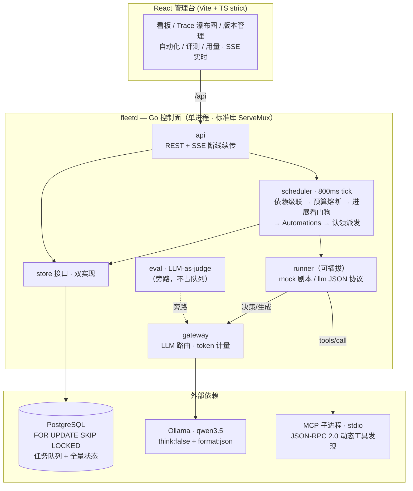

# agentfleet — 多 Agent 任务管控平台

把 agent 当队友管理：**任务分派 → 调度执行 → Handoff 协作 → 人工审批 → 全链路 Trace → 回归评测**。
Go 控制面 + React 管理台，本地 LLM 驱动（零 API 成本），`--mem` 模式零依赖开箱即跑。

> 定位：对标 [Multica](https://github.com/multica-ai/multica)/Orca 类「agent 劳动力管控面」——
> 不是又一个 Dify 仿品，而是管理**一支 agent 舰队**的生产级控制面。

**核心能力**：任务队列（优先级/依赖/并发闸/重试退避）· Handoff 状态机（指令一次性消费）·
审批门 + AI 预审 · 全链路 Trace（SSE）· **执行环境 Workspaces**（对标 worktree）·
**产物 Artifacts**（报告/补丁/日志落盘浏览）· **经验沉淀 Skills**（SOP 复用，注入不污染指令通道）·
Automations 定时派活 · LLM-as-judge 评测 · 预算熔断 + 进展看门狗 · Agent 版本管理（发布/回滚）·
MCP 工具接入 · 优雅停机 drain · 单二进制交付（16MB）。

## 30 秒上手

```bash
# 零依赖演示（内存存储，无 Postgres/Redis 需求；有 Ollama 走真模型，没有走 mock）
make run-mem          # API: http://localhost:8090  （Swagger 思路见 docs/api-contract.md）

# 管理台
cd web && npm install && npm run dev   # http://localhost:5173
```

```bash
# 生产模式（Postgres 任务队列：FOR UPDATE SKIP LOCKED，多实例安全）
docker compose up -d   # postgres + fleetd + web 一键起
```

## 5 分钟演示动线（现场/录屏）

1. **舰队总览 `/`**：5 个角色 agent 卡片（值班响应/修复执行/评审质检/数据分析/内容汇总）+ 右侧 SSE 实时事件流
2. **任务看板 `/tasks`**：种子任务链已自动跑完——点开「P2 告警：订单服务 P99 延迟上涨」
3. **Trace 瀑布图 `/tasks/6`**：`plan → text_search（工具步）→ handoff →fixer（交接）→ approval-gate（审批门）→ approval-passed（放行后重放）`——每步带耗时与 token
4. **审批闭环**：任务停在 review → 「通过」按钮 → 任务重新排队 → agent 看到 `[审批记录]` 确定性走完 → done
5. **自动化规则 `/automations`**：看 cron 规则的 last_run/next_run；`*/2 * * * *` 的规则会在 2 分钟内自动建一条任务并跑完（全链路无人工干预）
6. **评测中心 `/evals`**：发起「代码评审基准 v1」评测（真模型 judge），2-4 分钟出报告：score_avg / pass_rate / 逐 case 评语
7. **用量看板 `/usage`**：按 agent/模型聚合的 token 计量

## 架构



文字版速览：

```
React 管理台 ──/api──> Go 控制面（标准库 ServeMux，零路由依赖）
                        ├─ api         REST + SSE（Last-Event-ID 断线续传）
                        ├─ scheduler   认领(FOR UPDATE SKIP LOCKED)→并发闸→状态机→handoff/审批/重试
                        │              └─ Automations：cron 到期自动建任务（自研 cronexpr，120 行）
                        ├─ runner      可插拔执行器：mock（确定性剧本）/ llm（JSON 协议）/ 预留 Eino
                        ├─ gateway     LLM 路由 + 计量（Ollama 原生 think:false + format:"json"）
                        ├─ eval        LLM-as-judge 评测引擎（要点命中 + judge 评语）
                        └─ store       Postgres（生产）/ MemStore（演示+测试）双实现
```

详细设计（含三篇取舍小节）见 `docs/ARCHITECTURE.md`；API 契约见 `docs/api-contract.md`；剧本引擎手册见 `data/mock-playbook.md`；关键决策记录见 `docs/adr/`。

## 为什么这些选型（设计取舍速查）

| 讲点 | 一句话 | 深入位置 |
|---|---|---|
| 不用 Redis 的生产级队列 | 认领是单事务 `FOR UPDATE SKIP LOCKED`，依赖/并发/可见性全在 SQL 内判定，多实例天然安全 | `internal/store/postgres.go` ClaimNextTask |
| Handoff 状态机与指令一次性消费 | 交接指令被消费后必须从 prompt 全形态剥离，否则备注通道泄漏指令词导致连环误交接（真实踩坑记录） | `internal/scheduler/scheduler.go`；journal 11-06 |
| 审批门是状态机不是装饰 | review 状态阻断、approve 注入 `[审批记录]` 改写 prompt、runner 见标记确定性收尾 | `internal/api/api.go` taskAction |
| 存储双实现 | MemStore 让 CI 零外部依赖、测试确定性重放；Postgres 才是生产路径 | `internal/store/` |
| 本地 9B 模型结构化输出 | OpenAI 兼容端点的思考块会吃掉 max_tokens 导致 JSON 截断（实测 611s 假超时）；原生 `/api/chat` think:false + format:"json" 降到 17.5s | `internal/gateway/llm.go` |
| 自研 120 行 cron 而非引库 | 平台只需要 Next()，依赖洁癖优先 | `internal/cronexpr/`（含 dom/dow 或规则单测） |

## 测试与质量

```bash
make test        # go test -race 全量：状态机集成测试（handoff/审批/重试/并发闸）+ cronexpr 单测
make web-build   # 前端 tsc strict + vite build
make smoke       # 一键三连
```

## 设计原则

1. **LLM 是不可靠依赖**：模型挂了平台不挂——mock runner / 模板兜底 / mock 事件三级降级
2. **确定性优先**：调度、状态机、评分聚合全是纯代码；LLM 只做语言层的事
3. **可观测内建**：每步 llm/tool/handoff/gate 落库，SSE 实时推送，断线按 Last-Event-ID 续传
4. **零 API 成本**：本地 Ollama（qwen3.5 + bge-m3 同源经验），数据不出机器——FDE 私有化叙事

## Roadmap

`ROADMAP.md` 是活的：Automations✅ 剧本手册✅ 三评测集✅ → 接下来 Agent 版本管理 / MCP 工具接入 /
Eino 适配器 / 网关限流（持续迭代中，进度见 `docs/journal.md`）。

---
Built by Lyon Wang · AI-assisted multi-agent development workflow· 2026-11
